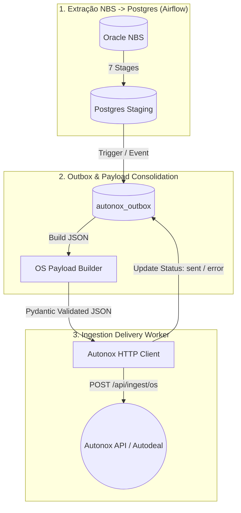

# Blueprint SPDD & Arquitetura: Evolução da Integração NBS -> Autonox (Autodeal / BMW)

> **Resumo**: Este documento sintetiza a avaliação da arquitetura discutida no ChatGPT share link, mapeia a estratégia de transição do projeto `nbs_extract_autodeal` e estrutura o blueprint de desenvolvimento e redação do artigo com base no artigo da Thoughtworks/Martin Fowler: **Structured-Prompt-Driven Development (SPDD)**.

---

## 1. Avaliação Crítica da Conversa do ChatGPT

A conversa compartilhada aborda a transição arquitetural do projeto `nbs_extract_autodeal`:
- **Estado Anterior**: O pipeline extraía 7 etapas de dados operacionais do Oracle (NBS) para tabelas estáticas no PostgreSQL (Staging/Consumo genérico).
- **Novo Desafio**: O destino final mudou. Agora os dados precisam alimentar diretamente a **API Ingestão do Autonox** (`/api/ingest/os`), que espera um **documento JSON consolidado por Ordem de Serviço (OS)** contendo atributos escalares e coleções aninhadas (cliente, veículo, peças, serviços, reclamações).

### 💡 Principais Decisões Arquiteturais Validadas:

1. **Manter o PostgreSQL como Camada Intermediária (Staging + State Management)**:
   - Eliminar o Postgres seria um erro, pois ele garante isolamento da carga do Oracle NBS, histórico local, auditabilidade e resiliência.
2. **Mudança de Paradigma na Unidade de Entrega**:
   - Na extração do NBS, a unidade são as 7 tabelas staging (`os_capa`, `itens_ordem_servico`, etc.).
   - Na entrega para a API Autonox, a **unidade de sincronização é a OS Completa**.
3. **Padrão Outbox / Fila de Entrega Persistente (`autonox_outbox`)**:
   - Desacoplar a **Extração (Oracle -> Postgres)** da **Ingestão (Postgres -> API Autonox)**.
   - Uma falha na API HTTP não deve reexecutar a extração pesada no Oracle NBS; deve apenas reprocessar os itens pendentes na fila local.
4. **Estratégia Incremental & Recuperação Histórica**:
   - Busca por data máxima + janela histórica para capturar OS antigas alteradas no NBS.
   - Garantia de idempotência no envio (Chave Dealer + Número OS).

---

## 2. Aplicação da Metodologia SPDD (Martin Fowler / Thoughtworks)

O artigo de Martin Fowler/Wei Zhang propõe o **Structured Prompt-Driven Development (SPDD)**:
- **Prompts como Artefatos de Primeira Classe**: Especificações estruturadas mantidas no repositório (ex.: pasta `docs/spdd/`), versionadas no Git e revisadas antes de gerar código.
- **Regra de Ouro**: *"Quando a realidade divergir ou a regra mudar, atualize a especificação/prompt primeiro — depois atualize o código."*
- **Estrutura REASONS Canvas**: Modelo de 7 partes para derivar a implementação de forma governável e determinística.

---

## 3. O REASONS Canvas para a Evolução do `nbs_extract_autodeal`

Este Canvas serve como o prompt blueprint oficial para guiar o desenvolvimento do projeto:



### 📋 Detalhamento das 7 Partes do REASONS Canvas:

#### **R — Requirements (Requisitos)**
- **Objetivo**: Extrair ordens de serviço e entidades vinculadas do Oracle NBS, consolidar em JSON conforme o contrato da API Autonox, e realizar o envio HTTP resiliente.
- **DoD (Definition of Done)**:
  - Tabela `autonox_outbox` criada para controle de estado (`pending`, `sent`, `error`, `retries`).
  - Módulo `PayloadBuilder` montando o JSON da OS com tipagem exata (Pydantic).
  - Cliente HTTP com *exponential backoff* e tratamento de status (200 OK, 4xx, 5xx).
  - DAG/Task no Airflow orquestrando o pipeline sem acoplamento rígido entre extração e envio.

#### **E — Entities (Entidades do Domínio)**
- **Domain Entities**: `OSCapa`, `ClienteOS`, `Veiculo`, `ItemOS` (Peças), `ServicoOS`, `ReclamacaoOS`, `FaturaOS`.
- **Integration Entities**:
  - `AutonoxOSPayload` (Modelo Pydantic que espelha o contrato JSON do Autonox).
  - `AutonoxOutboxRecord` (Modelo SQLAlchemy da tabela de controle `autonox_outbox`).
  - `AutonoxEmpresaConfigModel` (Modelo SQLAlchemy da tabela `autonox_empresa_config` para chaves API e parâmetros por loja).

#### **A — Approach (Estratégia Arquitetural)**
- Adotar a **arquitetura em 2 DAGs totalmente desacopladas**:
  - **DAG 1 (`pipeline_nbs_to_postgres.py`)**: Executa as 7 etapas de extração do Oracle NBS para o Staging Postgres (`0 * * * 1-6`).
  - **Fase 2 / DAG 2 (`pipeline_autonox_outbox_sync.py`)**: Executa com maior frequência (`*/15 * * * *`), lê a `autonox_outbox`, busca a chave de API da loja em `autonox_empresa_config`, constrói o JSON consolidado e consome a fila de envio para a API Autonox, sem impactar o banco Oracle.

#### **S — Structure (Estrutura do Projeto)**
```text
dags/
├── nbs_to_postgres.py         # DAG 1: Extração Oracle NBS -> PostgreSQL Staging
└── autonox_outbox_sync.py     # DAG 2: Ingestão Outbox -> API Autonox HTTP
include/
├── extract_stages/            # 7 etapas de extração Oracle -> Postgres
├── infra/                     # Conexões e engines (Oracle, Postgres)
├── models/
│   ├── autonox_outbox_model.py # Modelo SQLAlchemy da tabela autonox_outbox
│   └── autonox_empresa_config_model.py # Modelo SQLAlchemy de chaves/lojas
├── seeds/
│   └── empresa_config_seed.py # Seed inicial de lojas e chaves API
├── schemas/
│   └── autonox_payload_schema.py # Modelos Pydantic para validação do JSON da API
├── builders/
│   └── os_payload_builder.py  # Lógica de consolidação da OS
├── clients/
│   └── autonox_client.py      # Cliente HTTP resiliente para a API Autonox (com suporte a API key por loja)
└── services/
    └── sync_service.py        # Orquestração do Outbox & Ingestão multi-loja
```

#### **O — Operations (Passos de Execução / Task Breakdown)**
1. **Task O1**: Criar schema SQLAlchemy para `autonox_outbox` (`id`, `cod_empresa`, `numero_os`, `status`, `payload`, `attempts`, `last_error`, `created_at`, `updated_at`).
2. **Task O2**: Definir `AutonoxOSPayload` Pydantic schema alinhado ao contrato oficial do Autonox.
3. **Task O3**: Implementar `OSPayloadBuilder` em `include/builders/os_payload_builder.py`.
4. **Task O4**: Criar `AutonoxHttpClient` com suporte a autenticação por empresa/loja, timeouts e tratamento de erros.
5. **Task O5**: Criar modelo e seed `autonox_empresa_config` (`codigo_empresa`, `sigla`, `marca`, `api_key`, `is_active`).
6. **Task O6**: Implementar `SyncService.process_outbox()` para ler pendências, resolver a chave API por empresa, enviar à API e atualizar o status.
7. **Task O7**: Criar o DAG dedicado `pipeline_autonox_outbox_sync` (`dags/autonox_outbox_sync.py`) e manter o DAG de extração (`dags/nbs_to_postgres.py`) focado exclusivamente no NBS.

#### **N — Norms (Normas de Engenharia)**
- **Validação Dupla**: Pandera na entrada da Staging (Pandas/Oracle); Pydantic na saída para a API (JSON/HTTP).
- **Tipagem Estrita**: Python 3.12 type hints em todos os métodos dos *builders* e *clients*.
- **Log Estruturado**: Mensagens de log contendo `cod_empresa`, `numero_os` e `http_status` para rastreabilidade no Airflow.

#### **S — Safeguards (Salvaguardas & Invariantes)**
- **Limites de Tentativas**: Máximo de 5 retentativas por OS antes de marcar status como `failed_dead_letter`.
- **Isolamento de Erros**: Falha no envio de uma OS individual não paralisa o processamento das demais OS na fila.
- **Idempotência**: Requisições para o Autonox utilizam a chave composta (`cod_empresa` + `numero_os`) garantindo atualizações limpas em caso de reenvio.


---

## 4. Estrutura Proposta para o Artigo

Com base no projeto e na metodologia SPDD, o artigo pode ser estruturado nos seguintes tópicos principais:

### Título Sugerido:
> **Evoluindo Pipelines de Dados com SPDD: Caso Prático de Integração do DMS NBS ao Autonox (BMW) via Outbox Pattern**

### Sumário da Estrutura do Artigo:
1. **Introdução**:
   - O desafio comum: evoluir um pipeline de ETL tradicional (banco para banco) para uma integração baseada em APIs HTTP transacionais.
2. **O Contexto do Projeto (`nbs_extract_autodeal`)**:
   - Arquitetura original (Oracle NBS -> Staging PostgreSQL em 7 etapas).
   - O novo requisito da API Autonox (envio de payload JSON consolidado por Ordem de Serviço).
3. **Adoção do SPDD (Structured Prompt-Driven Development)**:
   - Por que usar a abordagem de Martin Fowler / Thoughtworks?
   - Mantendo o prompt e as especificações de arquitetura no repositório.
   - Apresentando o **REASONS Canvas** como guia da transformação.
4. **Desenho da Solução Técnica**:
   - O Padrão Outbox no PostgreSQL (`autonox_outbox`).
   - Construção do Payload Consolidado (do SQL ao Pydantic).
   - Desacoplamento no Airflow (Extração vs. Ingestão).
5. **Lições Aprendidas & Riscos de Negócio**:
   - Questões de integração: OS canceladas, substituição de coleções e resiliência HTTP.
6. **Conclusão**:
   - Como o SPDD evitou refatorações desordenadas e garantiu alinhamento entre o código e a intenção de arquitetura.
